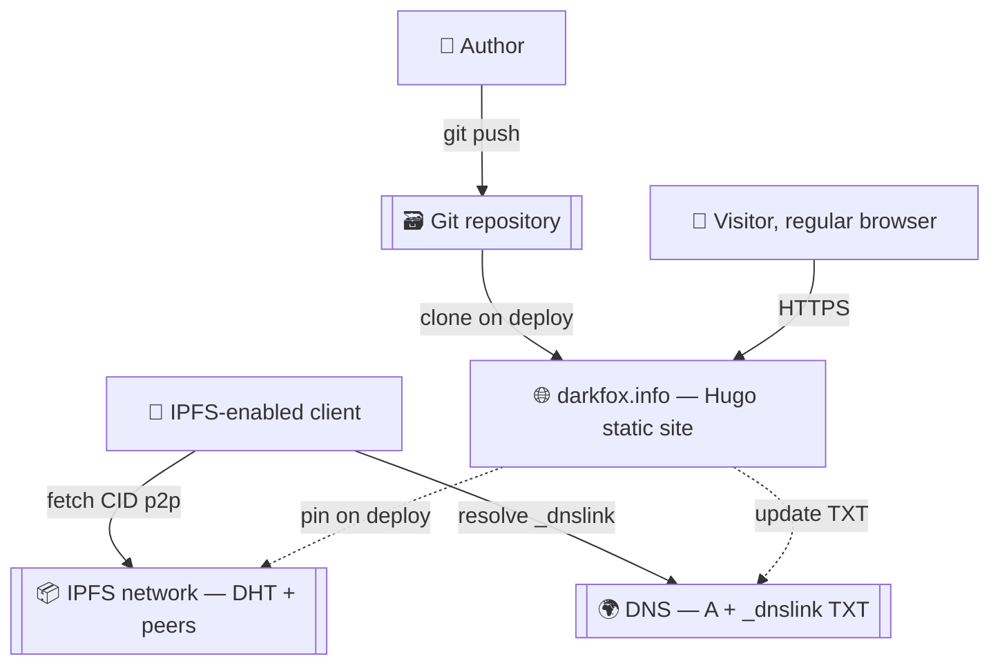
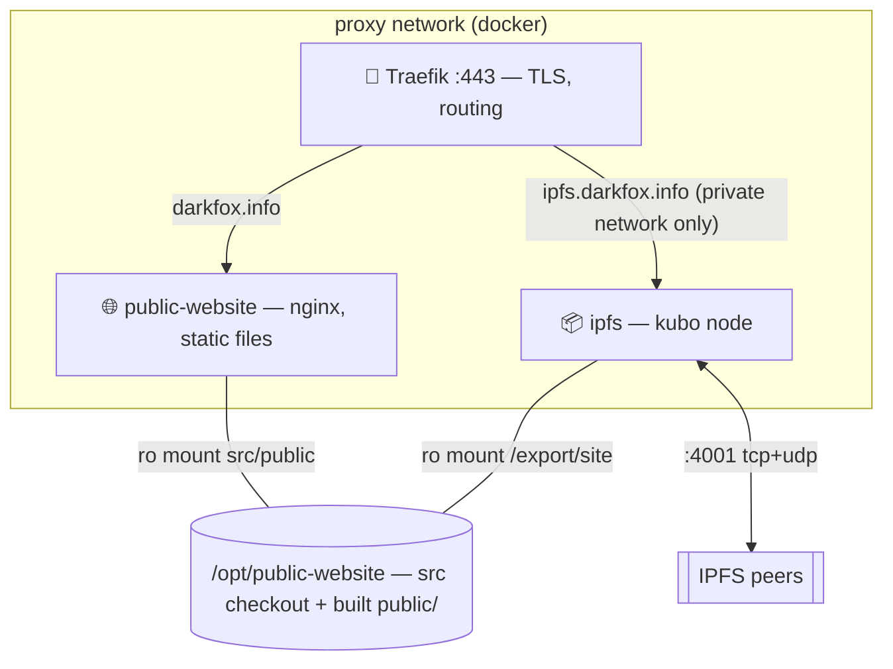

# darkfox.info - Architecture Documentation

## Overview

Personal site and blog: Hugo static site, bilingual (en/ru), served over HTTPS
from own VPS and mirrored to IPFS with a DNSLink pointer. Based on arc42 + C4 Model.

> **Source of truth**: site config in `hugo.toml`, content in `content/`,
> local sandbox in `deploy/compose.yaml`. Production deployment lives in the
> infra repository (`roles/public_website`, `roles/ipfs`) — see its
> `docs/architecture.md` for the host-level picture. When they disagree, the
> code wins.

---

## 1. Introduction and Goals

### 1.1 Requirements

**Business:**

- Personal presence: links hub, blog posts, about/resume pages (en/ru)
- Sovereign hosting: primary on own infrastructure, no platform lock-in
- Censorship resistance: content reachable even if the VPS or domain is blocked

**Non-functional:**

- Static output only — no server-side code, no database
- Every page carries SEO basics: canonical URL, OpenGraph, hreflang, RSS, sitemap
- Deploy is one idempotent Ansible run

### 1.2 Quality Goals

1. **Durability** — content survives infrastructure failures (IPFS snapshots,
   git history, repo mirrors)
2. **Simplicity** — one person maintains it; static files + two containers
3. **Discoverability** — search engines index the HTTPS origin; IPFS copies
   never compete with it (canonical links)

---

## 2. Constraints

- **Infrastructure**: existing VPS (2 vCPU / 4 GiB / 40 GiB, Fedora), Traefik
  as the only reverse proxy, Ansible-managed, images pinned + Renovate
- **Sovereignty**: deploy must not depend on external services; git hosting
  lives on own infrastructure
- **Disk budget**: IPFS repo capped at 5 GB (`Datastore.StorageMax`)
- **Team**: one person; anything requiring ceremony will rot

---

## 3. Context and Scope

### 3.1 C1: Context Diagram



**External systems:**

- **Git repository**: source of truth for content and config; deploy clones
  it over SSH with a read-only deploy key
- **DNS (Gandi LiveDNS)**: A/AAAA records and the `_dnslink` TXT pointer; one
  personal access token serves both ACME DNS-challenge and DNSLink updates
- **IPFS network**: peers replicate the pinned site content on demand

---

## 4. Solution Strategy

- **Hugo** builds markdown into static HTML; nginx serves it; Traefik
  terminates TLS. No runtime code = minimal attack surface and maintenance
- **Two transports, one content**: HTTPS is the canonical origin (SEO,
  humans); IPFS is the durability/censorship-resistance layer. Canonical
  `<link>` on every page keeps search engines pointed at HTTPS
- **Mutable pointer over immutable content**: each deploy produces a new CID
  (content hash of the whole site); `_dnslink.darkfox.info` TXT record is
  atomically switched to it. DNS is the phone book, content travels p2p
- **Everything is code**: content in git, deployment in Ansible roles,
  versions pinned and bumped by Renovate PRs

---

## 5. Building Block View

### 5.1 C2: Container Diagram (production VPS)



**Containers:**

- **nginx** (`nginx:alpine`): origin server for static files; no config beyond
  the default — Traefik does TLS and routing. nginx is not a second proxy:
  Traefik cannot serve files, an origin is required
- **kubo** (`ipfs/kubo`): IPFS node; pins the built site, serves it to the
  p2p network via swarm port 4001. HTTP gateway is exposed only inside the
  private network (`ipfs.darkfox.info`)
- Both mount the **stable parent directory** `/opt/public-website` read-only;
  Hugo recreates `src/public` on every deploy, and mounting the parent keeps
  the bind mount valid across rebuilds (see ADR-007)

### 5.2 Repository layout

```
hugo.toml            # site config: i18n en/ru, profile mode, menus, SEO
content/             # markdown; *.ru.md = Russian version of a page
  posts/<slug>/      # page bundles: index.md + index.ru.md + images
themes/PaperMod      # git submodule, never edited in place
deploy/compose.yaml  # local sandbox: nginx + kubo behind local Traefik
docs/architecture.md # this document
```

---

## 6. Runtime View

### 6.1 Deploy flow

```text
ansible-playbook playbooks/public_website/deploy.yml  (infra repo)
  1. git clone/pull the site repo over SSH (read-only deploy key,
     recursive: PaperMod submodule)
  2. docker run hugomods/hugo --minify → src/public
  3. docker compose up -d (nginx picks up files, no recreate needed)
  4. docker exec ipfs ipfs add -rQ --cid-version 1 /export/site/src/public → CID
  5. if CID changed:
       unpin previous CID (content garbage-collectable)
       write /opt/public-website/current_cid
       PUT _dnslink TXT via Gandi LiveDNS API
```

### 6.2 DNSLink resolution (IPFS client)

```text
client requests ipns://darkfox.info (or gateway /ipns/darkfox.info)
  1. DNS TXT query: _dnslink.darkfox.info → "dnslink=/ipfs/<CID>"
  2. client fetches <CID> from the p2p network (DHT locates providers,
     including our kubo node via :4001)
  3. content verified by hash — no trust in the transport required
Regular browsers skip all of this: A record → Traefik → nginx.
```

### 6.3 Content publishing

```text
author writes content/posts/<slug>/index.md (+ index.ru.md), draft: true
  → hugo server -D (local preview)
  → draft: false, git push
  → deploy playbook (manual for now; CI is a planned follow-up)
```

---

## 7. Deployment View

- **Production**: single VPS, containers behind Traefik on the `proxy` docker
  network. Deployment: Ansible roles `public_website` + `ipfs` in the infra
  repo; order matters only on first run (ipfs before public_website)
- **Firewall**: 4001 tcp+udp open publicly (swarm); gateway and API are not
  exposed to the internet
- **Local sandbox** (`deploy/compose.yaml`): same images and label-based
  routing behind the developer's local Traefik; domains
  `site-dev.darkfox.info` / `ipfs-dev.darkfox.info` resolve to the dev machine
  via private DNS. Build with
  `hugo --minify -b https://site-dev.darkfox.info/`

---

## 8. Crosscutting Concepts

### 8.1 SEO / duplication

- Absolute `baseURL`; PaperMod emits `<link rel="canonical">` on every page —
  critical because IPFS gateways serve byte-identical copies on other hosts
- hreflang pairs for en/ru, sitemap.xml, robots.txt, RSS (`/index.xml`),
  OpenGraph tags — all generated by Hugo/PaperMod

### 8.2 Security

- No server-side code; the only writable surface is the deploy path
  (SSH deploy key is read-only on the repo)
- Kubo API (:5001) never leaves the container network; gateway is
  restricted to the private network; only swarm :4001 is public
- Gandi token lives in Ansible Vault; the DNSLink update task is the only
  consumer besides Traefik's ACME

### 8.3 Versioning / rollback

- Site content: git revert + redeploy
- Previous CIDs remain fetchable until unpinned + GC'd; rollback of the IPFS
  copy = point `_dnslink` back at an old CID
- Container images pinned, bumped by Renovate PRs

---

## 9. Architecture Decisions

### ADR-001: Hugo as static site generator

- **Status**: accepted
- **Context**: need bilingual static site with themes ecosystem; candidates
  Hugo, Zola, Jekyll, 11ty
- **Decision**: Hugo — Go-based (hackable), <1ms/page builds, built-in i18n,
  RSS, sitemap; largest theme library
- **Consequences**:
  - ➕ Zero-dependency single binary, same image (`hugomods/hugo`) in CI/prod
  - ➖ Go templates have a learning curve

### ADR-002: PaperMod theme as git submodule

- **Status**: accepted
- **Context**: minimalism, en/ru, dark theme, RSS, active maintenance
- **Decision**: PaperMod, vendored as submodule; overrides only via `layouts/`
- **Consequences**:
  - ➕ Most-maintained Hugo theme, profile mode fits a links-hub homepage
  - ➖ Submodule adds a step to clone (`--recursive`)

### ADR-003: Self-hosted git hosting as deploy source

- **Status**: accepted
- **Context**: deploy must not depend on external availability
- **Decision**: origin on own git hosting (same infrastructure as the deploy
  target); public mirrors are passive copies, never a deploy dependency
- **Consequences**:
  - ➕ Deploy is self-contained; self-hosted Renovate does version PRs
  - ➖ One-time mirror setup for public visibility

### ADR-004: Self-hosted kubo node instead of a pinning service

- **Status**: accepted
- **Context**: original plan phased IPFS via Pinata/web3.storage first
- **Decision**: run own kubo on the VPS from day one; no third-party pinning
- **Consequences**:
  - ➕ Sovereignty: no external account, quota, or ToS
  - ➕ Disk is cheap for a static site (repo capped at 5 GB)
  - ➖ Availability of the IPFS copy depends on this single node (mitigated by
    any gateway/peer caching popular content; a second pin is a cheap upgrade)

### ADR-005: Clone over SSH with a read-only deploy key

- **Status**: accepted
- **Context**: repo is public, but the git server rejects anonymous
  git-over-HTTP (web UI is open, `info/refs` returns 401)
- **Decision**: deploy clones over SSH with a read-only deploy key registered
  on the repo
- **Consequences**:
  - ➕ Same transport as all other infra git usage; least-privilege key
  - ➖ One manual step per new deploy host (register its key)

### ADR-006: Absolute baseURL, no relativeURLs

- **Status**: accepted; superseded by ADR-009 once that is implemented
- **Context**: `relativeURLs=true` would make IPFS snapshots fully
  self-contained, but breaks canonical/OG absolute links
- **Decision**: keep absolute `baseURL = https://darkfox.info/`
- **Consequences**:
  - ➕ SEO correctness; one canonical origin
  - ➖ The IPFS copy is not standalone on any gateway. The stylesheet is
    root-relative (`/assets/css/…`), so path gateways
    (`<gateway>/ipns/darkfox.info/`) serve pages unstyled. Menu, home and
    language links are absolute, so on subdomain/DNSLink gateways they lead
    back to the origin
  - ➖ Conflicts with the censorship-resistance requirement (1.1): with the
    origin blocked, the IPFS copy cannot be navigated through the menu
- **Revised 2026-10-08**: the original version claimed that assets load from
  the canonical origin and that subdomain/DNSLink gateways are unaffected;
  the build output shows otherwise (consequences above)

### ADR-007: Bind-mount the stable parent directory into kubo

- **Status**: accepted (post-incident)
- **Context**: first deploy mounted `src/public` directly; Hugo recreates that
  directory each build → new inode → running container kept a stale mount
  (`readdirent ENOENT`)
- **Decision**: mount `/opt/public-website` (created once, never deleted) and
  pin the `src/public` subpath, which the kernel resolves live
- **Consequences**:
  - ➕ Mount survives any number of rebuilds without container restarts
  - ➖ Container sees slightly more than it strictly needs (read-only)

### ADR-008: Wiki features on Hugo instead of a wiki-native generator

- **Status**: accepted (implementation pending)
- **Context**: posts originate in an Obsidian vault and link to each other
  with `[[wikilinks]]`; a set of interlinked articles also wants backlinks
  and callouts. Quartz 4 provides all of this out of the box; Astro was the
  other candidate considered for wiki-like sites
- **Decision**: stay on Hugo and add the missing pieces with render hooks
  and a publishing preprocessor:
  - the preprocessor (part of the vault → repo export) rewrites syntax only:
    `[[note|alias]]` → `[alias](<content path>)`, using a vault-name → slug
    table built from the vault frontmatter
  - `_markup/render-link.html` resolves the target with `GetPage`, which
    looks only in the current language; a missing page (unpublished or
    untranslated) renders as plain text
  - `_markup/render-blockquote.html` renders `> [!NOTE]` alerts — the same
    syntax as Obsidian callouts
  - backlinks: a partial that scans `site.RegularPages` for links to the
    current page
  - graph view and hover previews only once the site has dozens of
    interlinked pages
- **Alternatives**:
  - Quartz 4 publishes a vault folder as is and has one locale per site:
    the en/ru setup with hreflang would be lost, and curated translated
    content (EN is not a mirror of RU) does not fit the publish-a-folder
    model
  - Astro has proper i18n, but wikilinks, backlinks and graph are still own
    code (`remark-wiki-link` plus own indexing), on top of rewriting the
    theme and moving the deploy build from the Hugo image to Node
  - Neither fixes IPFS self-containment by itself (see ADR-009)
- **Consequences**:
  - ➕ No migration: deploy role, theme and i18n stay as they are
  - ➕ Links to unpublished or untranslated pages degrade to text without
    per-translation manual editing
  - ➕ Checked on Hugo 0.165 in a scratch site (flat pages, en/ru): link
    resolution, alerts and backlinks take about 15 lines of templates
  - ➖ Goldmark does not parse `[[...]]`, so the preprocessor is own code
  - ➖ The backlinks scan is O(n²) over pages; irrelevant below a few hundred
  - **Retreat path**: if a digital garden appears (dozens of interlinked
    notes where the network matters more than the feed), build it with
    Quartz into a subdirectory of this site — one deploy, one CID — instead
    of migrating the blog

### ADR-009: Separate relative-URL build for the IPFS pin

- **Status**: proposed; supersedes ADR-006 when implemented
- **Context**: under ADR-006 the IPFS copy depends on the origin for
  styling (path gateways) and navigation (all gateways), which defeats
  requirement 1.1. A single build cannot serve both: menu links become
  relative only with `baseURL = "/"`, which also makes canonical, OG and
  JSON-LD URLs relative, while RSS and sitemap need absolute URLs. With
  `baseURL = "/"` PaperMod's BreadcrumbList JSON-LD also loses a comma
  between items and `--minify` fails (Hugo 0.165, checked 2026-10-08)
- **Decision**: build twice from the same commit:
  - HTTPS build — unchanged (absolute `baseURL`), served by nginx
  - IPFS build — `baseURL = "/"` with `relativeURLs = true` into a sibling
    output directory under `/opt/public-website`, pinned and published via
    DNSLink
  - override `_partials/head.html` (canonical) and
    `_partials/templates/schema_json.html` (JSON-LD, breadcrumb comma) to
    take the origin from a site param, so both stay absolute in both builds
- **Consequences**:
  - ➕ The IPFS copy is navigable on any gateway and without the origin
  - ➕ Canonical still points every copy at `https://darkfox.info`
  - ➕ Compatible with ADR-007: the second output lives under the same
    stable mounted parent
  - ➖ Two builds per deploy, a second Makefile target, a changed pin path
    in the deploy role
  - ➖ `head.html` is overridden as a whole file, so upstream PaperMod
    changes to it have to be merged by hand on submodule bumps
  - ➖ RSS and sitemap in the IPFS build carry relative URLs; acceptable,
    feeds are consumed from the origin

---

## 10. Risks and Technical Debt

| Risk / debt | Impact | Mitigation / plan |
| --- | --- | --- |
| Manual deploy (no CI) | Stale prod after push | CI: push → build → deploy (planned) |
| Single IPFS node | IPFS copy offline if VPS down | Optional second pin (another node or service) later |
| Public mirror not yet configured | No offsite copy | One-time push-mirror setup (pending) |
| kubo GC not scheduled | Unpinned CIDs linger | `ipfs repo gc` periodic or `--enable-gc`; low urgency at 5 GB cap |
| PaperMod uses Hugo APIs deprecated in 0.158 (`.Language.LanguageCode` etc.) | Deploy build breaks on the Hugo release that removes them; prod image is pinned (0.163.3) and bumped by Renovate PRs that merge unbuilt while there is no CI | Bump the PaperMod submodule together with Hugo; run `make build` on Renovate PRs until CI exists |
| IPFS copy depends on the origin for styling and navigation | Censorship resistance (1.1) only partial: menu and language links lead to the blocked origin | ADR-009 (proposed) |

Improvement backlog (search, og:images, resume-as-code, Tor/Yggdrasil
transports, identity hub) lives in the issue tracker under the
`project:darkfox-info` label, not here.

---

## 11. Glossary

| Term | Definition |
| --- | --- |
| **CID** | Content IDentifier — hash of content; changes when content changes |
| **DNSLink** | DNS TXT record (`_dnslink.<domain>`) pointing a stable name at a CID |
| **IPNS** | IPFS's own mutable pointer system; DNSLink is the DNS-based alternative |
| **kubo** | Reference IPFS node implementation (Go) |
| **Pinning** | Marking content as protected from garbage collection on a node |
| **Swarm port** | :4001 — p2p port where an IPFS node talks to other peers |
| **Page bundle** | Hugo convention: directory with `index.md` + assets as one page |
| **Profile mode** | PaperMod homepage layout: avatar, subtitle, buttons, social icons |

---

**Document Version**: 1.1
**Last Updated**: 2026-10-08
**Owner**: foxcool
**Status**: Active
